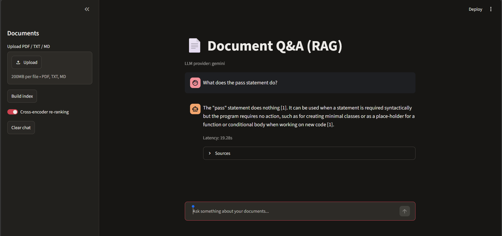
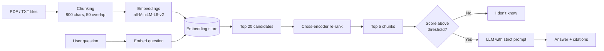

# 📄 RAG Document Q&A

Ask questions about your PDFs in plain English and get answers **with source citations**, or an honest *"I don't know"* when the answer isn't in the documents.



## Features
- **Semantic search** with MiniLM sentence embeddings and exact cosine-similarity vector search (NumPy)
- **Two-stage retrieval:** fast dense search (top 20), then a **cross-encoder re-ranker** (top 5)
- **Grounded answers with citations:** every answer points to file and page
- **Hallucination control:** strict prompt + similarity threshold that returns "I don't know" instead of guessing
- **Conversation memory** for follow-up questions
- **Swappable LLM:** Gemini, OpenAI, Anthropic or Ollama (free, local) via one environment variable
- **Built-in evaluation:** Recall@k and MRR script, so every design choice is measured
- **Streamlit UI:** upload documents, build the index and chat in the browser

## Architecture


## Tech stack
Python · PyTorch · Hugging Face Transformers · NumPy · pypdf · Streamlit · Gemini 

## Quickstart
```bash
git clone https://github.com/<your-username>/rag-qa-system.git
cd rag-qa-system
python -m venv .venv && source .venv/bin/activate   # Windows: .venv\Scripts\activate
pip install -r requirements.txt

# 1. Put your PDFs in docs/ and build the index
python -m src.ingest

# 2. Choose an LLM (PowerShell syntax; use `export` on Mac/Linux)
$env:LLM_PROVIDER="gemini"
$env:GEMINI_API_KEY="your-key"                 # free key: https://aistudio.google.com
$env:GEMINI_MODEL="gemini-3.5-flash-lite"      # optional; model names change often
# Other options: LLM_PROVIDER=openai (OPENAI_API_KEY), anthropic (ANTHROPIC_API_KEY),
# or ollama (free, local; run `ollama pull llama3.2`)

# 3. Launch the app
python -m streamlit run app.py
# or, in the terminal:  python chat.py
```

## Configuration
Edit `src/config.py`, or set environment variables.

| Setting | Default | Meaning |
|---|---|---|
| `CHUNK_SIZE` / `OVERLAP` | 800 / 50 | Chunking (characters) |
| `TOP_K` | 5 | Chunks sent to the LLM |
| `RETRIEVE_K` | 20 | Candidates fetched before re-ranking |
| `MIN_SCORE` | 0.25 | Below this cosine similarity, answer "I don't know" |
| `LLM_PROVIDER` | ollama | `ollama`, `openai` or `anthropic` |

## Evaluation
Evaluated on **45 questions** over the official Python tutorial (17 plain-text files, 333 chunks at 800 characters). A question counts as a hit when its answer keyword appears in one of the top 5 retrieved chunks.

| Setup | Recall@5 | MRR |
|---|---|---|
| Dense search only | 80.0% | 0.606 |
| Dense + cross-encoder re-ranker | **93.3%** | **0.819** |

Chunk-size experiment (`python -m src.ingest --chunk-size N`):

| Chunk size | Chunks | Dense Recall@5 | + Re-ranker Recall@5 |
|---|---|---|---|
| 300 | 983 | 71.1% | 84.4% |
| 500 | 551 | 68.9% | 86.7% |
| 800 | 333 | 80.0% | 93.3% |

**Takeaways:** the re-ranker improves Recall@5 by 13-18 points at every chunk size. Larger chunks score higher, partly because a bigger chunk is more likely to contain the keyword, so the chunk-size comparison is indicative rather than a pure quality ranking.

**Reproduce:**
1. Download the plain-text Python docs from https://docs.python.org/3/download.html and copy the `.txt` files from the `tutorial` folder into `docs/`.
2. `python -m src.ingest`
3. `python check_questions.py --fix` (drops questions whose keyword is not in your files)
4. `python evaluate.py`

## Design decisions
- **all-MiniLM-L6-v2:** small, fast, free, runs on CPU, good quality for its size.
- **Chunk overlap:** stops answers from being cut across chunk boundaries.
- **Two-stage retrieval:** a bi-encoder is fast but approximate; a cross-encoder reads question and chunk together and is more accurate, so it re-orders only the top 20.
- **Threshold + strict prompt:** two layers against hallucination (skip the LLM if nothing relevant, and force "I don't know" if context is insufficient).
- **NumPy cosine search on normalized vectors:** exact results with zero extra dependencies; fast for tens of thousands of chunks. For millions of chunks, swap in FAISS or a vector DB.

## Project structure
```
rag-qa-system/
├── app.py              # Streamlit UI
├── evaluate.py         # Recall@k / MRR / answer accuracy
├── check_questions.py  # validates eval keywords against your docs
├── chat.py             # terminal chat (no Streamlit needed)
├── src/
│   ├── config.py       # settings
│   ├── ingest.py       # load, chunk, embed, index
│   ├── embedder.py     # embedding model + cross-encoder (PyTorch)
│   ├── retriever.py    # search + re-rank
│   ├── llm.py          # Ollama / OpenAI / Anthropic
│   └── rag.py          # full pipeline
├── eval/               # evaluation questions
└── docs/               # put your documents here
```

## Limitations and future work
- Character-based chunking can split mid-sentence; sentence or section-aware chunking would help.
- Tables and scanned PDFs (no text layer) are not handled; OCR would be needed.
- Answer accuracy is checked with keyword matching; an LLM judge (e.g. RAGAS) would be more precise.
- Hybrid search (BM25 + dense) could improve exact-term queries.
- Approximate-nearest-neighbour index (FAISS/Chroma) for very large corpora.
- Streaming responses and per-user document stores.

## License
MIT
